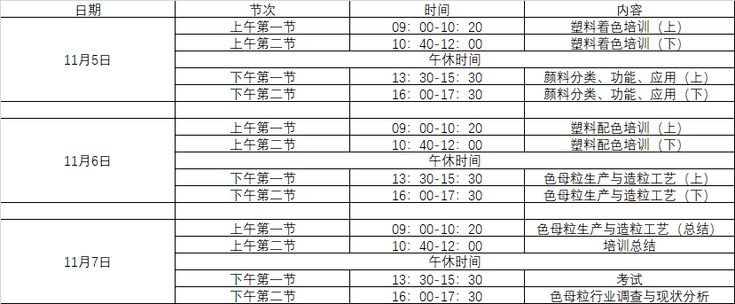
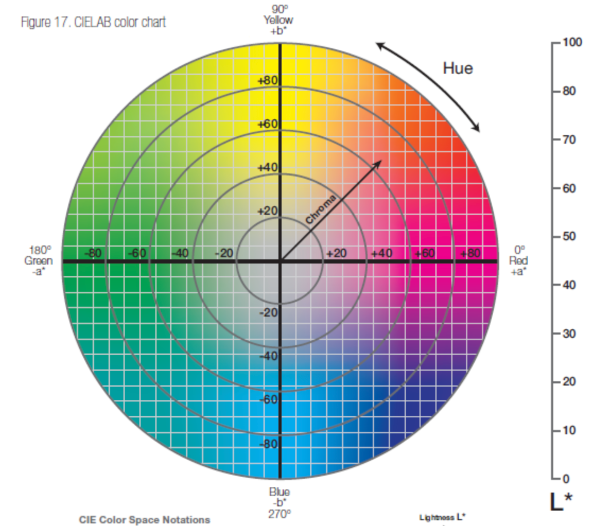

# 色母粒培训 · 张鹏龙

## 色母粒培训

### 导师简介

#### 张鹏龙

#### 38年从业经验

### 塑料着色培训

#### 发展史

##### 塑料改变生活

###### 塑料是从石油、天然气、煤基本合成

###### 塑料替代其他材料

###### 塑料制品种类繁多

##### 塑料着色是个系统工程

###### 应用性能

###### 应用对象

###### 应用工艺

###### 应用配方

###### 应用场所

#### 第一部分 塑料着色有机颜料的技术要求

##### 物体的颜色

###### 光源、物体、眼睛的相互作用

###### 光是一种电磁波，带着辐射的能量

###### 在不同颜色空间有不同的颜色表现

###### 荧光的生产线必须和普通的生产线分开

###### 测色仪和分光光度计有什么区别

###### 麦克亚当颜色的宽容量

###### 色彩的三属性（LCH）：亮度、色调、鲜艳度（饱和度）

###### 颜色幻觉：周边颜色对视觉产生了影响

###### 颜料索引号

- TDS报告、MSDS报告中，需要明确颜料索引号
###### 着色力：着色力高，用的颜料少

- 1/3色力度
- 标准深度
#### 第二部分 塑料着色有机颜料的品种和性能

##### 性能

###### 耐迁移

###### 耐光性（8级）、耐候性（5级，提高耐候性要加抗氧剂）

###### 耐候性（5级，提高耐候性要加抗氧剂）

- 阳光、湿度、露水、大气成分、时间等，都有影响
- chan hu 灯
###### 塑料收缩的原因

- 热胀冷缩原理
- 无机颜料影响小，有机颜料影响大
- 塑料分类
  - 热塑性材料
  - ？？？
- 翘曲的评定
##### 着色剂的分类

###### 有机着色剂

- 有机颜料
  - 偶氮类
  - 酞青类
  - 稠环类（高性能）
- 溶剂颜料
###### 无机着色剂

### 颜料分类、功能、应用

### 塑料配色培训

### 色母粒生产与造粒工艺
